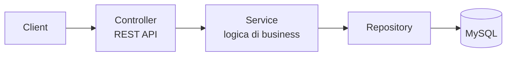
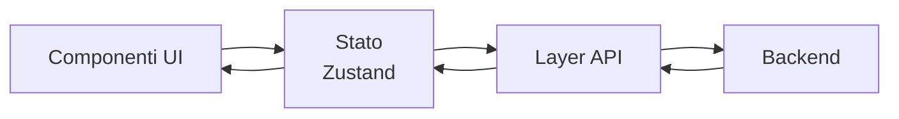
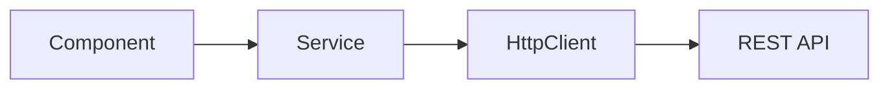
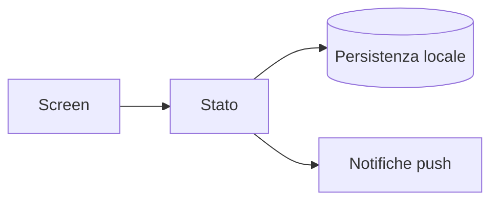
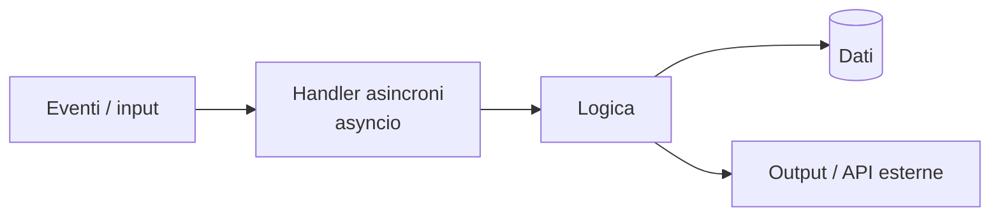
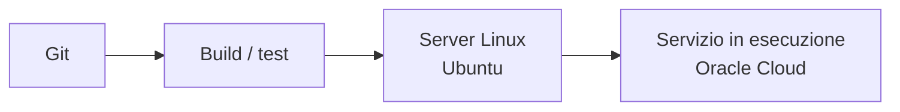

## Chi sono

Sviluppatore full-stack, nato in Bolivia e in Italia da 15 anni. Trilingue: spagnolo madrelingua, italiano C2, inglese B2.
Ho lavorato su un ERP in produzione per clienti aziendali, in un team internazionale a Malta e su progetti personali che arrivano fino al deploy su Linux.
Cerco un team in cui crescere su progetti reali.

 

## Stack

**Frontend** &nbsp; `React` `Angular` `TypeScript` `JavaScript` `Material UI` `Zustand` `Bootstrap`
**Backend** &nbsp; `Java` `Spring Boot` `REST API` `Python`
**Dati** &nbsp; `MySQL` `SQL` `Supabase (RLS, trigger, realtime)`
**Mobile** &nbsp; `React Native (Expo)`
**Infrastruttura e metodo** &nbsp; `Linux (Ubuntu)` `Oracle Cloud` `Git` `Agile/Scrum`

  

 

## Come sviluppo

Gli schemi che uso per ragionare quando parto da zero con una tecnologia. Cambiano gli strumenti, non l'idea: ogni livello ha una responsabilità sola.

### Java / Spring Boot

### React

### Angular

### React Native (mobile)

### Python (asincrono)

### Dal codice al deploy

 

## Perché scegliere me?

<b>Perché non mi sono specializzato in una sola tecnologia?</b>

 

Perché le tecnologie cambiano e il vantaggio sta nell'adattarsi, più che nel conoscerne una sola a fondo. Ho scelto di toccare stack anche molto diversi tra loro (Java, React, Angular, Python, Supabase, Linux) per imparare cosa resta uguale sotto: modellare i dati, separare le responsabilità, gestire gli errori. Quando arriva uno strumento nuovo, parto da quelle basi.

<b>Come lo dimostro, oltre a dirlo?</b>

 

Con i fatti: in tre esperienze consecutive ho lavorato con tre stack diversi (Java/JSP/jQuery in un ERP, Angular + Spring Boot in un'app web, React + Supabase a Malta) e dopo la formazione ho aggiunto Python e API OpenAI. In più ho portato un progetto personale fino al deploy su Linux.

<b>Che valore porta un profilo che vede tutta la filiera?</b>

 

`[DA CONFERMARE CON TE]` Bozza: so cosa succede dall'interfaccia al database fino al server su cui gira il codice. Questo mi aiuta a parlare con colleghi di front-end e back-end, a capire dove nasce un problema e a non fermarmi al mio pezzo.

 

## Contatti

[LinkedIn](#) · [Email](#) · [Portfolio](#)

