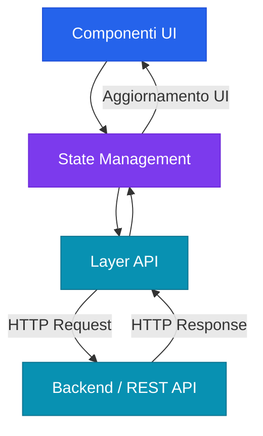
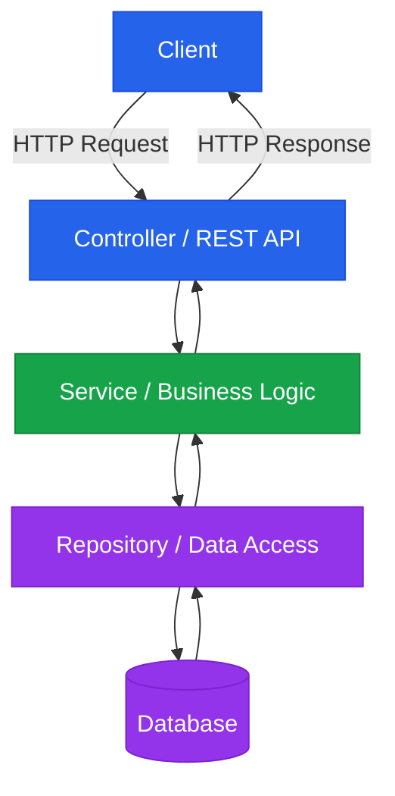
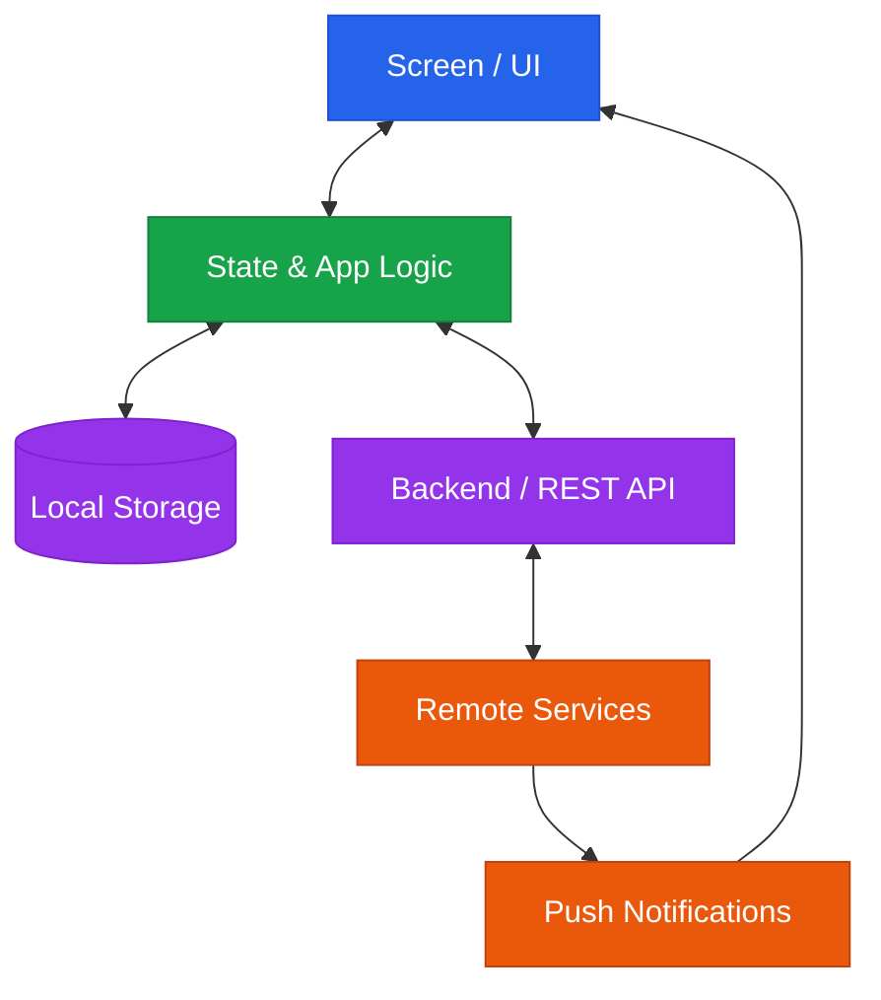
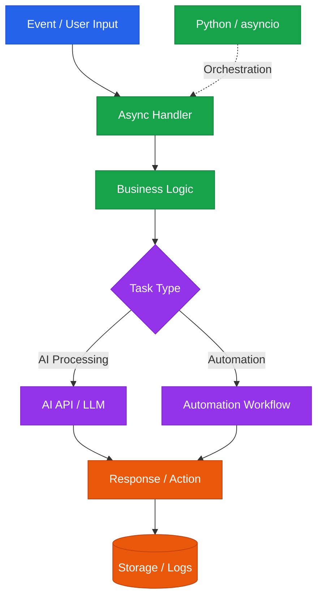
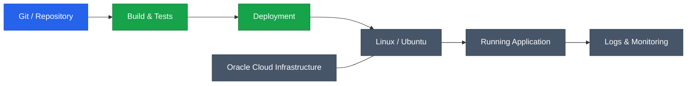

## Who I am

Full-Stack Software Developer passionate about building practical software solutions, from intuitive user interfaces to backend logic, database management, and deployment. Experienced in enterprise ERP systems, international Agile teams, web and mobile development, automation, and AI-powered applications. Combining technical skills with a strong interest in UX, design, and problem-solving. Italian, Spanish, and English.

 

## Why Me?

<b>Why did I choose to work across different technologies instead of specializing in just one?</b>

 

I believe the direction technology is taking is pushing us to become more versatile developers: people who can work across different technologies, understand different areas of software development, and adapt to new challenges.

The tech world moves incredibly fast. The way we build software today may look very different a year from now. In my opinion, adaptability is essential at every level of seniority. That's why I chose not to limit myself to a single programming language or framework. I want to understand different technologies, recognize the principles they share, and be ready to learn and adapt as the industry evolves.

<b>What value can I bring to a company?</b>

 

I see a Full-Stack Developer as more than someone who works on both frontend and backend. Especially in small and medium-sized businesses, I believe this role can bring value by understanding and contributing to a wide range of technological needs: from building websites and business management systems to creating digital content, integrating services, and maintaining or debugging legacy software.

I bring experience with modern technologies used in professional software development, together with a broad set of complementary skills. My goal is to understand the bigger picture, identify what a project needs, and contribute wherever my skills can make a difference, while continuing to learn and grow with the team.

## Tech Stack

**Frontend**

  
  
  
  
  
  
  
  
  
  

**Backend**

  
  
  
  

**Database & Data**

  
  
  
  
  

**Mobile Development**

  
  

**Cloud, Tools & Methodologies**

  
  
  
  
  
  
  

## Come sviluppo

Gli schemi che uso per ragionare quando parto da zero con una tecnologia. Cambiano gli strumenti, non l'idea: ogni livello ha una responsabilità sola.

### Frontend Development

### Backend Development

### Mobile Development

### AI & Automation

    
### Deployment & Infrastructure

 aving&color=0:30363d,100:0d1117&height=60&section=footer" width="100%" alt="footer" />
