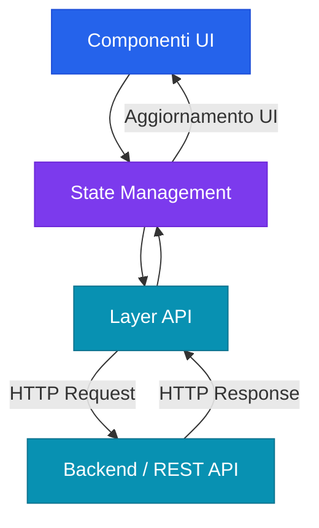
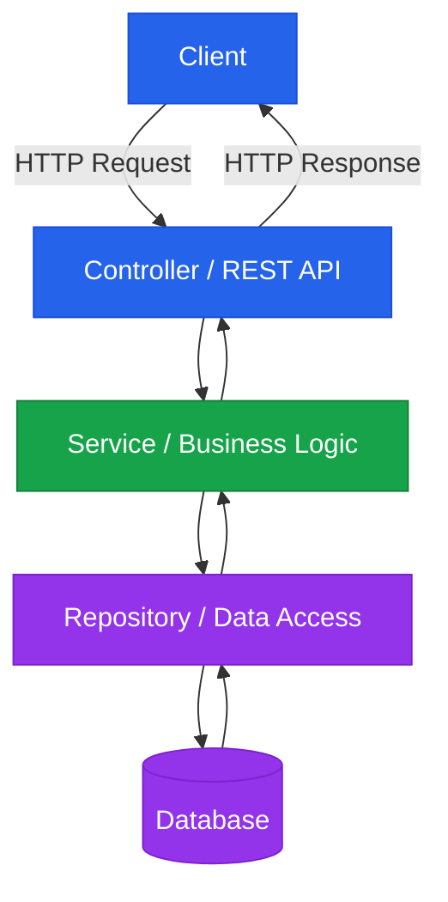
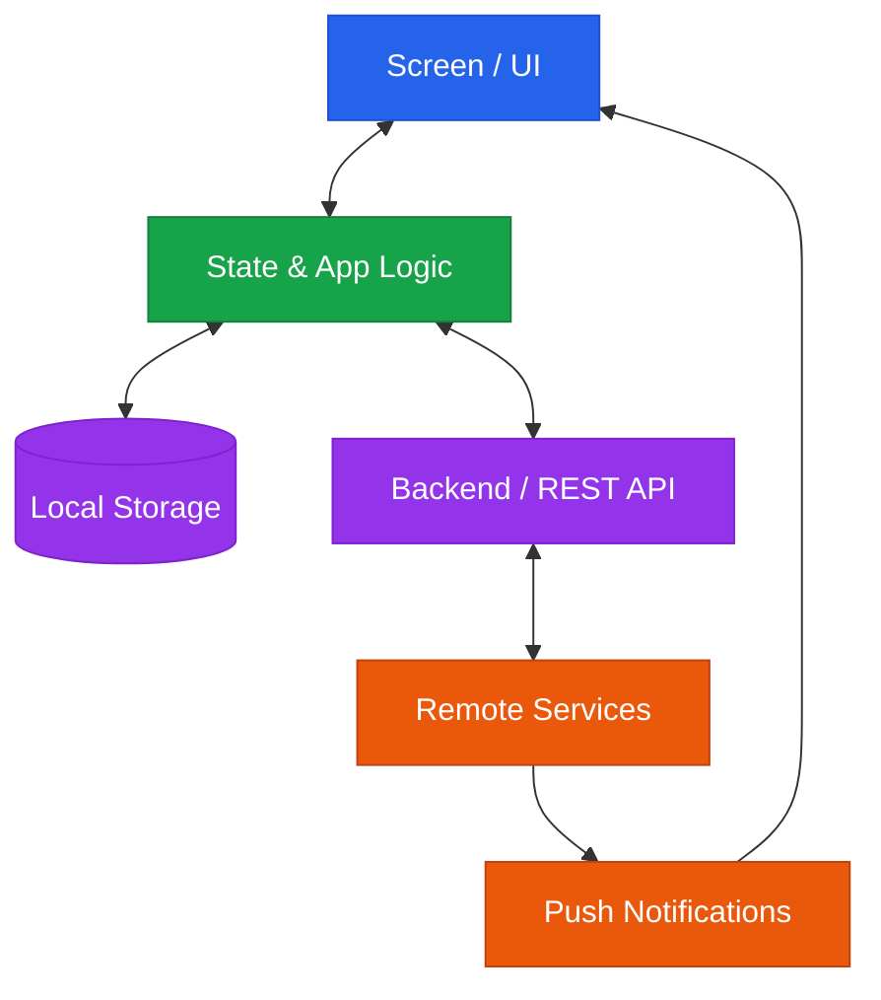
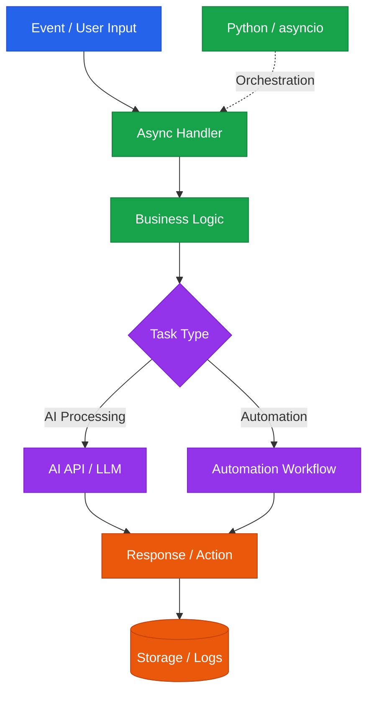
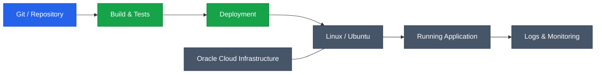

## Chi sono

Full-Stack Software Developer passionate about building practical software solutions, from intuitive user interfaces to backend logic, database management, and deployment. Experienced in enterprise ERP systems, international Agile teams, web and mobile development, automation, and AI-powered applications. Combining technical skills with a strong interest in UX, design, and problem-solving. Italian, Spanish, and English.

 

## Tech Stack

**Frontend**

  
  
  
  
  
  
  
  
  
  

**Backend**

  
  
  
  

**Database & Data**

  
  
  
  
  

**Mobile Development**

  
  

**Cloud, Tools & Methodologies**

  
  
  
  
  
  
  

## Why Me?

<b>Why should you choose me?</b>

 

I'm a versatile Full-Stack Developer with hands-on experience across different technologies, projects, and development environments. I've worked on a production ERP system, contributed to web applications in different tech stacks, collaborated with an international team, and built personal projects involving mobile development, Python automation, and cloud deployment.

I adapt to new tools by focusing on the fundamentals that matter: clean code, separation of concerns, problem-solving, and maintainable solutions. I'm looking for a team where I can contribute, take on real challenges, and keep growing as a developer.

<b>What value can I bring to your company?</b>

 

I can contribute across the development lifecycle, from building user interfaces and implementing business logic to working with databases, integrating APIs, and deploying applications on Linux.

My experience across different stacks helps me understand how the different parts of an application fit together, collaborate effectively with frontend and backend developers, and investigate issues beyond a single layer. Combined with my adaptability, attention to usability, and ability to work in Italian, Spanish, and English, I bring a flexible, collaborative mindset to a development team.

## Come sviluppo

Gli schemi che uso per ragionare quando parto da zero con una tecnologia. Cambiano gli strumenti, non l'idea: ogni livello ha una responsabilità sola.

### Frontend Development

### Backend Development

### Mobile Development

### AI & Automation

    
### Deployment & Infrastructure

 

## Perché scegliere me?

<b>Perché non mi sono specializzato in una sola tecnologia?</b>

 

Perché le tecnologie cambiano e il vantaggio sta nell'adattarsi, più che nel conoscerne una sola a fondo. Ho scelto di toccare stack anche molto diversi tra loro (Java, React, Angular, Python, Supabase, Linux) per imparare cosa resta uguale sotto: modellare i dati, separare le responsabilità, gestire gli errori. Quando arriva uno strumento nuovo, parto da quelle basi.

<b>Come lo dimostro, oltre a dirlo?</b>

 

Con i fatti: in tre esperienze consecutive ho lavorato con tre stack diversi (Java/JSP/jQuery in un ERP, Angular + Spring Boot in un'app web, React + Supabase a Malta) e dopo la formazione ho aggiunto Python e API OpenAI. In più ho portato un progetto personale fino al deploy su Linux.

<b>Che valore porta un profilo che vede tutta la filiera?</b>

 

`[DA CONFERMARE CON TE]` Bozza: so cosa succede dall'interfaccia al database fino al server su cui gira il codice. Questo mi aiuta a parlare con colleghi di front-end e back-end, a capire dove nasce un problema e a non fermarmi al mio pezzo.

 

## Contatti

[LinkedIn](#) · [Email](#) · [Portfolio](#)

